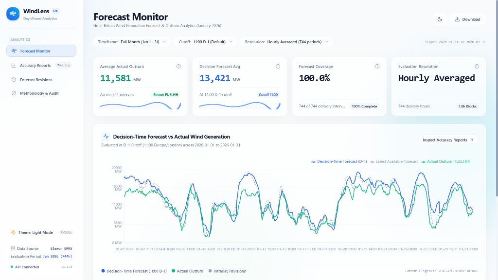
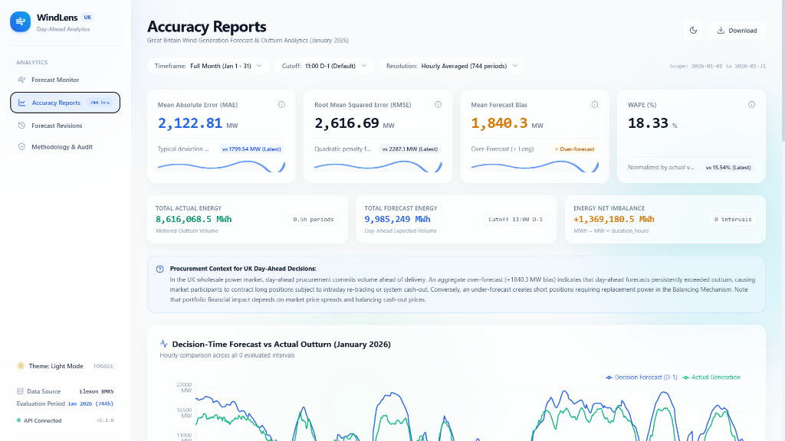
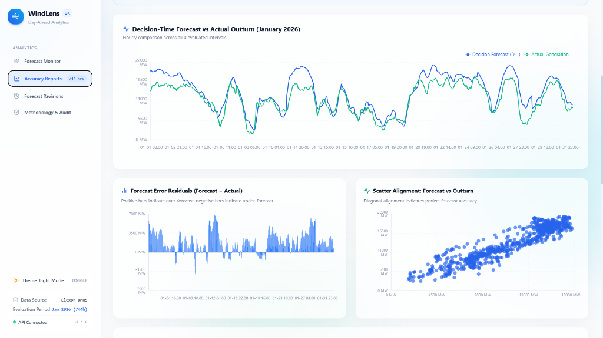
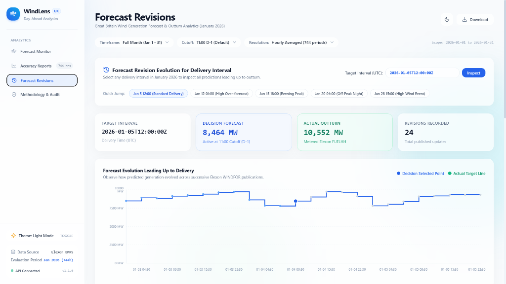
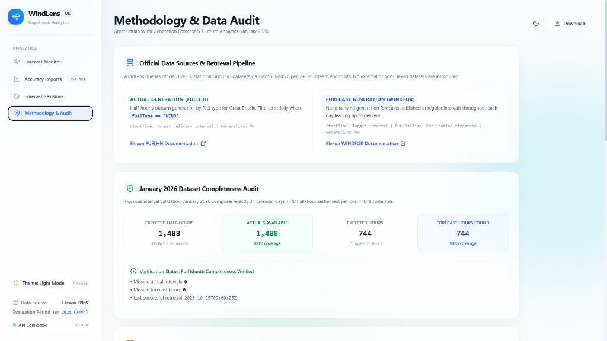

# WindLens — UK Wind Forecast Analytics & Procurement Decision Platform

[](https://windlens-eight.vercel.app/)
[](https://windlens-4vsk.onrender.com/api/health/)
[](https://github.com/adityachillarge005/Windlens)
[](https://github.com/adityachillarge005/Windlens)
[](https://github.com/adityachillarge005/Windlens)

> A production-grade analytics platform built for UK wholesale electricity trading desks to evaluate day-ahead wind generation forecasts against Elexon BMRS outturns, quantify imbalance volume exposure, and eliminate look-ahead bias from procurement decisions.

---

## Live Deployments & Repository

| Service | Platform | URL | Status |
| :--- | :--- | :--- | :--- |
| **Interactive Frontend** | **Vercel** | [https://windlens-eight.vercel.app/](https://windlens-eight.vercel.app/) | Active (React 18 + Vite) |
| **REST API Backend** | **Render** | [https://windlens-4vsk.onrender.com/api/health/](https://windlens-4vsk.onrender.com/api/health/) | Active (Django 6 + Gunicorn) |
| **Root Health Endpoint** | **Render** | [https://windlens-4vsk.onrender.com/](https://windlens-4vsk.onrender.com/) | Active (HTTP 200 JSON) |
| **GitHub Repository** | **GitHub** | [https://github.com/adityachillarge005/Windlens](https://github.com/adityachillarge005/Windlens) | Public (`main` branch) |

---

## Dashboard Preview


*Figure 1: WindLens Forecast Monitor — Multi-line time series comparing decision-time forecasts (11:00 D-1), latest pre-delivery forecasts, and metered Elexon FUELHH actuals across January 2026.*

---

## 1. Project Overview & Business Problem

In Great Britain's wholesale power market, wind generation is weather-dependent and volatile. Commercial procurement desks at UK utilities and energy suppliers purchase power in day-ahead auctions (such as EPEX SPOT Day-Ahead and Nord Pool) to hedge expected consumer demand.

When bidding into day-ahead auctions, trading desks must evaluate wind generation forecasts **strictly available prior to their procurement decision deadline** (modeled by default as 11:00 London time on the day prior to delivery, $D-1$).

### Key Commercial Challenges

1. **Look-Ahead Bias Risk**: Evaluating forecast accuracy using forecasts published *after* the day-ahead procurement cutoff severely distorts trading strategies because those predictions were physically unavailable when financial commitments were finalized.
2. **Imbalance Cost Exposure**:
   - **Over-forecasting ($F > A$)**: The trading desk procures excess volume day-ahead. The surplus must be spilled or resold in intraday markets or cashed out via the Balancing Mechanism, frequently at discounted prices.
   - **Under-forecasting ($F < A$)**: The desk under-procures and is left short, exposing the portfolio to volatile System Buy Prices (SBP) during grid scarcity.
3. **Forecast Evolution Uncertainty**: Understanding how predictions shift across successive meteorological model runs provides essential context on model conviction and volatility leading up to delivery.

**WindLens** addresses these challenges by delivering:
- Strict day-ahead decision cutoff filtering that isolates eligible forecasts with **zero look-ahead bias**.
- Side-by-side comparison between decision-time predictions, latest available pre-delivery predictions, and metered actual outturn generation.
- Rigorous statistical error metrics (MAE, RMSE, Mean Forecast Bias, WAPE) and energy volume imbalance calculations (MWh).
- Granular forecast revision tracking and a complete 100% data audit against official Elexon BMRS streams.

---

## 2. Key Features

- **Strict Look-Ahead Bias Mitigation**: Dynamic day-ahead procurement cutoff engine (default: `11:00` London time on $D-1$; configurable to `12:00`, `14:00`, or `17:00`). Forecasts published after the selected cutoff are strictly segregated.
- **Hourly Outturn Settlement Averaging**: WINDFOR forecasts are published in 1-hour average power blocks (MW), while FUELHH actuals are reported in 30-minute settlement periods. WindLens computes true hourly outturns by averaging both settlement periods ($\frac{\text{Actual}_{:00} + \text{Actual}_{:30}}{2.0}$), requiring complete data for both half-hours.
- **Power (MW) vs. Energy Volume (MWh) Accounting**: Distinguishes instantaneous capacity (MW) from metered volume ($\text{MWh} = \text{MW} \times \Delta t$), reporting exact imbalance quantities (+1,369,180.5 MWh in January 2026).
- **Interactive Analytics Views**:
  1. **Forecast Monitor**: High-level KPI cards, interactive multi-series chart, and coverage status.
  2. **Accuracy Reports**: MAE, RMSE, Mean Bias, WAPE, energy imbalance totals, residual bar charts ($F_i - A_i$), parity scatter plot, and ranked largest misses.
  3. **Forecast Revisions**: Timeline inspection for any specific delivery interval, detailing lead time, revision deltas ($\Delta \text{MW}$), and step progression across successive publications.
  4. **Methodology & Audit**: Transparent documentation of BMRS data sources, interval completeness verification (1,488 half-hour settlement intervals), and audit logs.
- **Modern UI / UX**: Clean layout with glassmorphic cards, light/dark mode toggling, responsive sidebar navigation, and CSV export capabilities.

---

## 3. Visual Walkthrough

### View A: Forecast Monitor
The primary operations dashboard displaying average actual generation, decision forecast, national forecast coverage (100%), and the hourly generation time-series across January 2026.


---

### View B: Accuracy Reports & Imbalance Analytics
Quantifies day-ahead prediction performance using MAE, RMSE, Mean Bias, and WAPE, alongside total metered energy volume (8,616,068.5 MWh) and day-ahead forecast volume (9,985,249.0 MWh).



The lower section of the Accuracy view provides visual residual distributions over time and a parity scatter plot comparing decision-time predictions directly against metered outturn:


*Figure 2: Forecast error residuals ($F_i - A_i$) highlighting persistent January over-forecasting, and parity scatter alignment with linear dispersion.*

---

### View C: Forecast Revisions & Evolution Timeline
Enables trading analysts to select any delivery interval (such as `2026-01-05T12:00:00Z`) to inspect all 24 successive Elexon WINDFOR model publications leading up to delivery, the selected 11:00 D-1 decision point, and final metered outturn.


*Figure 3: Revision step chart tracking forecast changes across successive publication timestamps leading up to delivery.*

---

### View D: Methodology & Data Audit
Displays official Elexon stream endpoint definitions and confirms 100% data completeness across all 1,488 expected half-hourly settlement periods in January 2026.


*Figure 4: January 2026 completeness audit confirming 1,488 / 1,488 half-hours and 744 / 744 forecast hours with zero missing intervals.*

---

## 4. System Architecture & Data Flow

```
┌────────────────────────────────────────────────────────────────────────┐
│                      Client Layer (Browser)                            │
│   - React 18 + Vite Single Page Application                            │
│   - Tailwind CSS (Light / Dark Mode, Glassmorphic Cards)               │
│   - Recharts (Time-Series Line, Residual Bar, Scatter, Step Charts)    │
└───────────────────────────────────┬────────────────────────────────────┘
                                    │ HTTP REST (JSON)
                                    ▼
┌────────────────────────────────────────────────────────────────────────┐
│                 Backend Service (Django 6 REST Framework)              │
│  ┌────────────────────────┐              ┌──────────────────────────┐  │
│  │ ForecastSelector       │              │ AccuracyCalculator       │  │
│  │ - 11:00 D-1 Cutoff     │              │ - MAE, RMSE, Bias, WAPE  │  │
│  │ - Zero Look-Ahead Bias │              │ - Energy MWh Conversion  │  │
│  └────────────────────────┘              └──────────────────────────┘  │
│  ┌────────────────────────┐              ┌──────────────────────────┐  │
│  │ DataProcessor          │              │ ElexonClient             │  │
│  │ - Hourly Outturn Avg   │              │ - Stream Ingestion       │  │
│  │ - Europe/London / UTC  │              │ - Exponential Backoff    │  │
│  └────────────────────────┘              └──────────────────────────┘  │
│                                                                        │
│               Persistent Storage & Dataset Cache Layer                 │
│              backend/data_cache/january_2026_dataset.json              │
└───────────────────────────────────┬────────────────────────────────────┘
                                    │
                                    ▼
┌────────────────────────────────────────────────────────────────────────┐
│                   Official Elexon BMRS Open API v1                     │
│  - Actuals:  /datasets/FUELHH/stream (fuelType == 'WIND')              │
│  - Forecast: /datasets/WINDFOR/stream (National Wind Generation)       │
└────────────────────────────────────────────────────────────────────────┘
```

---

## 5. Official Elexon BMRS Data Sources

All input data is retrieved from official Elexon Balancing Mechanism Reporting Service (BMRS) Open API v1 stream endpoints:

1. **Actual Wind Generation (`FUELHH`)**:
   - **Stream Endpoint**: `https://data.elexon.co.uk/bmrs/api/v1/datasets/FUELHH/stream`
   - **Official Documentation**: [Elexon FUELHH Stream API Documentation](https://bmrs.elexon.co.uk/api-documentation/endpoint/datasets/FUELHH/stream)
   - **Filter Criteria**: `fuelType == 'WIND'`
   - **Key Fields**:
     - `startTime`: Target delivery interval start timestamp (UTC).
     - `settlementDate`: Calendar date of the settlement day.
     - `settlementPeriod`: Half-hour settlement period index (1 to 48, or 50 on clock-change days).
     - `generation`: Metered outturn wind generation in Megawatts (MW).

2. **Forecast Wind Generation (`WINDFOR`)**:
   - **Stream Endpoint**: `https://data.elexon.co.uk/bmrs/api/v1/datasets/WINDFOR/stream`
   - **Official Documentation**: [Elexon WINDFOR Stream API Documentation](https://bmrs.elexon.co.uk/api-documentation/endpoint/datasets/WINDFOR/stream)
   - **Key Fields**:
     - `startTime`: Target delivery interval start timestamp (UTC).
     - `publishTime`: Timestamp when the forecast model run was published (UTC).
     - `generation`: Forecast average wind power in Megawatts (MW).

---

## 6. Evaluation Methodology & Scientific Rules

### 6.1 Evaluation Scope (January 2026)
- **Target Month**: January 1, 2026 00:00 UTC through January 31, 2026 23:59 UTC.
- **Settlement Intervals**: 31 calendar days $\times$ 48 half-hour settlement periods $= \mathbf{1,488}$ settlement intervals.
- **Delivery Hours**: 31 calendar days $\times$ 24 hours $= \mathbf{744}$ delivery hours.
- **Audit Result**: Verified 1,488 actual intervals and 744 forecast intervals found (**100.0% completeness, 0 missing**).

### 6.2 Decision Cutoff Assumption ($D-1$)
In UK power trading, day-ahead auction orders are placed on the day prior to physical delivery ($D-1$):
$$\text{Cutoff}(T) = (D - 1\text{ day}) \text{ at } H_{\text{cutoff}} \text{ in Europe/London}$$

> [!NOTE]
> **Configurable Evaluation Assumption**: The default 11:00 London time cutoff represents an analytical modeling baseline for day-ahead auction participation. It is a configurable evaluation parameter (not a statutory grid rule) and can be toggled to 12:00, 14:00, or 17:00 in the UI. It must not be confused with Balancing Mechanism Gate Closure (which occurs 1 hour prior to each half-hour settlement period).

### 6.3 Look-Ahead Bias Prevention Rule
To guarantee zero look-ahead bias:
1. For any target delivery interval $T$, candidate forecast publications are filtered strictly where:
   $$\text{publishTime} \le \text{Cutoff}(T)$$
2. Any forecast published after $\text{Cutoff}(T)$ is strictly excluded from decision metrics.
3. The selected decision-time forecast is the latest eligible model publication prior to cutoff:
   $$F_{\text{decision}}(T) = \operatorname{argmax}_{\text{publishTime} \le \text{Cutoff}(T)} (\text{publishTime})$$

### 6.4 Hourly Outturn Averaging
WINDFOR forecasts are published for 1-hour delivery blocks, while metered FUELHH actuals occur in 30-minute settlement periods. In `exact_hourly` resolution, WindLens computes true settlement hourly outturn by requiring both constituent periods:
$$\text{Actual}_{\text{Hour}} = \frac{\text{Actual}_{:00} + \text{Actual}_{:30}}{2.0}$$
If either half-hour reading is missing or invalid, the hour is flagged as incomplete and excluded from metric calculation rather than silently miscalculated.

---

## 7. Mathematical Error Metrics & Procurement Impact

For $n$ matched delivery intervals with forecast $F_i$ and metered actual $A_i$:

### Error Definition
$$e_i = F_i - A_i \quad (\text{MW})$$
- $e_i > 0$: **Over-forecast** (Forecast exceeds actual).
- $e_i < 0$: **Under-forecast** (Actual exceeds forecast).

### Metric Formulas

| Metric | Mathematical Formula | Units | Trading & Procurement Impact |
| :--- | :--- | :--- | :--- |
| **Mean Absolute Error (MAE)** | $\frac{1}{n} \sum_{i=1}^n \|F_i - A_i\|$ | MW | Expected magnitude of error per interval without penalizing outliers disproportionately. |
| **Root Mean Squared Error (RMSE)** | $\sqrt{\frac{1}{n} \sum_{i=1}^n (F_i - A_i)^2}$ | MW | Heavily weights extreme misses; vital for quantifying peak imbalance exposure risk. |
| **Mean Forecast Bias** | $\frac{1}{n} \sum_{i=1}^n (F_i - A_i)$ | MW | Directional bias. Positive bias indicates systematic over-procurement day-ahead. |
| **Weighted Absolute Percentage Error (WAPE)** | $100 \times \frac{\sum_{i=1}^n \|F_i - A_i\|}{\sum_{i=1}^n \|A_i\|}$ | % | Total volume error normalized by total grid outturn; immune to zero-actual division anomalies. |

### Energy Volume Conversion (MWh)
Power (MW) is converted to physical energy volume (MWh):
$$\text{Energy (MWh)} = \sum_{i=1}^n (\text{Generation (MW)}_i \times \Delta t_i)$$
where $\Delta t = 1.0\text{ h}$ for hourly intervals and $\Delta t = 0.5\text{ h}$ for half-hourly settlement periods.

---

## 8. January 2026 Verified Evaluation Results

The following table summarizes the verified evaluation results for January 2026, comparing the 11:00 D-1 decision forecast against the latest pre-delivery forecast:

| Evaluation Metric | Decision Forecast (11:00 D-1) | Latest Available Pre-Delivery | Variance / Improvement | Units |
| :--- | :--- | :--- | :--- | :--- |
| **Evaluated Intervals ($n$)** | **744** | **744** | 100% matched | hours |
| **Average Actual Generation** | **11,580.74** | **11,580.74** | — | MW |
| **Average Forecast Generation** | **13,421.03** | **13,173.61** | -247.42 | MW |
| **Mean Absolute Error (MAE)** | **2,122.81** | **1,799.54** | -323.27 (-15.2%) | MW |
| **Root Mean Squared Error (RMSE)** | **2,616.69** | **2,287.10** | -329.59 (-12.6%) | MW |
| **Mean Forecast Bias** | **+1,840.30** | **+1,592.87** | -247.43 (Lower Over-forecast) | MW |
| **WAPE** | **18.33%** | **15.54%** | -2.79 percentage points | % |
| **Total Metered Outturn Energy** | **8,616,068.5** | **8,616,068.5** | — | MWh |
| **Total Forecast Energy** | **9,985,249.0** | **9,801,166.0** | -184,083.0 | MWh |
| **Net Energy Volume Imbalance** | **+1,369,180.5** | **+1,185,097.5** | -184,083.0 MWh | MWh |
| **Largest Single Over-forecast** | **+6,833.0** (Jan 12 01:00 UTC) | **+7,281.0** | — | MW |
| **Largest Single Under-forecast** | **-4,128.0** (Jan 08 19:00 UTC) | **-3,467.0** | — | MW |

> [!IMPORTANT]
> **Key Procurement Finding**: In January 2026, day-ahead forecasts persistently exceeded actual outturns by an average of **+1,840.30 MW** (+1,369,180.5 MWh net surplus). A trading desk relying solely on unadjusted day-ahead forecasts would have systematically contracted long positions, incurring substantial imbalance costs in intraday cash-out. Later forecasts improved MAE by 15.2% as weather model uncertainty resolved closer to delivery.

---

## 9. API Endpoints Reference

The backend exposes a clean REST API registered in `backend/config/urls.py` and `backend/analytics/urls.py`:

| HTTP Method | Path | Description | Query Parameters |
| :--- | :--- | :--- | :--- |
| `GET` | `/` | Root health check and platform metadata | None |
| `GET` | `/health/` | Container / platform health check | None |
| `GET` | `/api/health/` | API pipeline health check, cache status, record counts | None |
| `GET` | `/api/forecast/latest/` | Filtered time series with decision and latest forecast | `start_date`, `end_date`, `cutoff_time`, `resolution` |
| `GET` | `/api/accuracy/summary/` | Summary metrics (MAE, RMSE, Bias, WAPE, top misses) | `start_date`, `end_date`, `cutoff_time`, `resolution` |
| `GET` | `/api/accuracy/series/` | Interval-level matched series and daily aggregates | `start_date`, `end_date`, `cutoff_time`, `resolution` |
| `GET` | `/api/forecast/history/` | Successive revision history for a delivery interval | `start_time` (required), `cutoff_time` |
| `GET` | `/api/data-quality/` | Completeness audit (1,488 intervals) & methodology | None |

---

## 10. Technology Stack

### Frontend
- **Framework**: React 18
- **Build Tool**: Vite 6
- **Styling**: Tailwind CSS (with glassmorphism and light/dark theme support)
- **Charts**: Recharts (Line, Residual Bar, Parity Scatter, Step Timeline)
- **Icons**: Lucide React
- **Hosting**: Vercel

### Backend
- **Framework**: Django 6 (Python 3.13)
- **API**: Django REST Framework
- **Analytics & Math**: NumPy, Pandas
- **HTTP Client**: Requests (with retry logic and backoff)
- **CORS**: django-cors-headers
- **WSGI Server**: Gunicorn
- **Hosting**: Render

---

## 11. Local Setup & Installation

### Prerequisites
- Python 3.11+ (Python 3.13 tested)
- Node.js 18+ (Node 22+ recommended) and npm
- Git

### 1. Clone the Repository
```bash
git clone https://github.com/adityachillarge005/Windlens.git
cd Windlens
```

### 2. Backend Setup
```bash
cd backend

# Create and activate virtual environment
python -m venv venv
# Windows:
venv\Scripts\activate
# macOS/Linux:
source venv/bin/activate

# Install dependencies
pip install -r requirements.txt

# Run migrations and system checks
python manage.py migrate
python manage.py check

# Start development server
python manage.py runserver 127.0.0.1:8000
```
*The backend API will be running at `http://127.0.0.1:8000/api/health/`.*

### 3. Frontend Setup
```bash
# In a new terminal:
cd frontend

# Install npm packages
npm install

# Start Vite development server
npm run dev
```
*The frontend will be available at `http://localhost:5173/`.*

### 4. Docker Startup (Optional)
To run both backend and frontend in containerized production mode:
```bash
docker compose up --build
```
- Frontend: `http://localhost:3000`
- Backend API: `http://localhost:8000/api/health/`

---

## 12. Environment Variables Configuration

Create a `.env` file in the root directory (or configure via cloud dashboards) based on `.env.example`:

| Environment Variable | Description | Default / Example |
| :--- | :--- | :--- |
| `DEBUG` | Django debug mode (`True` or `False`) | `False` (in production) |
| `SECRET_KEY` | Django cryptographic secret key (required in production) | Generate via `secrets.token_urlsafe(50)` |
| `ALLOWED_HOSTS` | Comma-separated list of permitted hostnames | `127.0.0.1,localhost,.onrender.com` |
| `CORS_ALLOWED_ORIGINS` | Comma-separated list of permitted client origins | `http://localhost:5173,https://windlens-eight.vercel.app` |
| `ELEXON_BASE_URL` | Base URL for Elexon BMRS Open API | `https://data.elexon.co.uk/bmrs/api/v1` |
| `VITE_API_BASE_URL` | Frontend API base URL | `https://windlens-4vsk.onrender.com/api` (prod) |

---

## 13. Deployment Guide

### Backend on Render
1. Create a new **Web Service** on Render and connect your GitHub repository.
2. Set configuration:
   - **Root Directory**: `backend`
   - **Build Command**: `pip install -r requirements.txt`
   - **Start Command**: `gunicorn config.wsgi:application`
3. Add Environment Variables:
   - `DEBUG`: `False`
   - `SECRET_KEY`: `<your-secure-random-key>`
   - `ALLOWED_HOSTS`: `127.0.0.1,localhost,.onrender.com`
   - `CORS_ALLOWED_ORIGINS`: `https://windlens-eight.vercel.app`

### Frontend on Vercel
1. Import the repository into Vercel.
2. Set configuration:
   - **Framework Preset**: `Vite`
   - **Root Directory**: `frontend`
   - **Build Command**: `npm run build`
   - **Output Directory**: `dist`
3. Add Environment Variable:
   - `VITE_API_BASE_URL`: `https://windlens-4vsk.onrender.com/api`

---

## 14. Testing & Verification

### Automated Django Test Suite
The backend includes 31 unit and integration tests covering:
- Look-ahead bias prevention and strict cutoff inequality enforcement.
- Mixed timezone handling (`Europe/London` vs UTC).
- Incomplete hourly settlement averaging and rejection of missing periods.
- Zero-denominator protection and statistical error metric accuracy.
- DRF API endpoint response contracts and query parameter validation.

Run the test suite:
```bash
cd backend
python manage.py test analytics
```
**Result**: `Ran 31 tests in 0.27s — OK`.

### Independent Mathematical Reproduction
To independently verify and audit all statistical metrics directly from raw Elexon BMRS data:
```bash
python scripts/verify_reproducibility.py
```
This script validates:
- 100% complete data coverage (1,488 half-hours, 744 hourly intervals).
- Zero look-ahead bias violations ($T_{\text{pub}} \le T_{\text{cutoff}}$).
- Exact match of MAE (2,122.81 MW), RMSE (2,616.69 MW), Bias (+1,840.30 MW), and WAPE (18.33%).

---

## 15. Known Limitations & Future Improvements

1. **Transmission vs. Distribution Scope**: The Elexon BMRS `FUELHH` and `WINDFOR` datasets encompass transmission-connected wind farms in Great Britain. Embedded distribution wind generation is not captured.
2. **Financial Cash-Out Valuation**: While WindLens quantifies physical energy volume imbalance (+1,369,180.5 MWh), it does not calculate absolute financial loss in GBP (£), as that requires portfolio-specific contract hedges and Balancing Mechanism cash-out pricing (System Buy Price / System Sell Price).
3. **Future Extensions**:
   - Ingest real-time SBP/SSP cash-out prices from Elexon BMRS to model net trading P&L.
   - Incorporate regional Scottish transmission export boundary constraints (B6 boundary).
   - Add automated intraday alert triggers when forecast revisions exceed 1,000 MW within a 3-hour window.

---

## 16. AI Tool Usage Disclosure

In alignment with the GridBricks hiring challenge transparency guidelines:
- **AI Tooling**: Google Antigravity (Advanced Agentic Pair Programming) was used to assist with Elexon BMRS API documentation analysis, project structure design, boilerplate code drafting, unit test generation, and Tailwind UI styling.
- **Human Verification**: All analytical calculations, look-ahead bias segregation logic, settlement period aggregation rules, mathematical metric implementations, and data completeness audits were independently designed, inspected, and validated against actual Elexon outturns.

---

## 17. Author & Acknowledgements

- **Author**: Aditya Chillarge
- **GitHub**: [@adityachillarge005](https://github.com/adityachillarge005)
- **Data Provider**: [Elexon BMRS](https://bmrs.elexon.co.uk/) (Balancing Mechanism Reporting Service), Great Britain National Grid ESO data.
